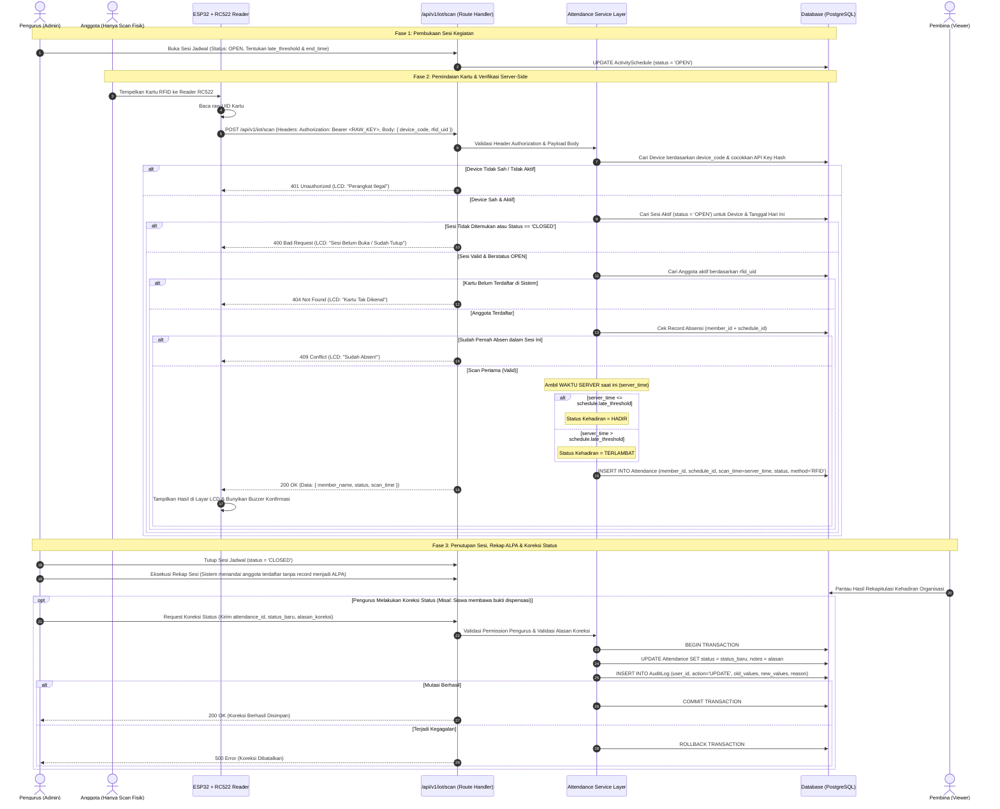

# System Architecture & Application Blueprint
**OSIS MPK SMKN 11 BANDUNG — Attendance & Management System**
*Version: 2.1 (Refined — Post Task 02 Review & Final Project Owner Decisions)*

Dokumen ini merupakan cetak biru (blueprint) arsitektur sistem resmi yang telah disempurnakan berdasarkan hasil review Task 02 dan keputusan final project owner. Dokumen ini menjadi rujukan teknis definitif sebelum melangkah ke implementasi skema database, API, atau antarmuka pengguna.

---

## 1. Project Overview

Sistem Absensi & Manajemen OSIS MPK SMKN 11 Bandung adalah platform berbasis web dan Internet of Things (IoT) yang bertujuan mengotomatisasi, menertibkan, serta merekapitulasi kehadiran dan kedisiplinan anggota OSIS dan perwakilan MPK secara real-time dan terintegrasi.

### Karakteristik & Kebutuhan Utama
1. **Kegiatan Rutin Absensi:**
   - **Sapa Pagi:** Absensi kehadiran piket sambut siswa di gerbang/sekolah setiap pagi.
   - **Danusan (Dana Usaha):** Absensi piket operasional pencarian dana/kewirausahaan organisasi.
   - **Nyisir 4P (Patroli Pagi / Peduli Pelanggaran & Penertiban):** Absensi penugasan penertiban tata tertib siswa SMKN 11 Bandung.
   - **Kegiatan Tambahan:** Rapat pleno, rapat koordinasi sekbid/komisi, kepanitiaan acara/proker khusus.
2. **Integrasi Perangkat IoT (ESP32 + RC522):**
   - Pemindaian kartu identitas RFID via modul RC522 dan mikrokontroler ESP32 DevKit V1.
   - Komunikasi REST API via HTTPS dengan autentikasi perangkat berbasis HTTP Authorization Header (API Key Hash).
   - Tampilan status instan pada layar LCD perangkat (Hadir, Terlambat, Kartu Tak Dikenal, Sesi Tutup, Koneksi Putus).
3. **Integritas Data & Audit Trail:**
   - Satu anggota hanya boleh memiliki 1 record absensi per sesi kegiatan (*unique constraint*).
   - Riwayat kehadiran tidak boleh terhapus (*immutable history*) meskipun anggota berganti status menjadi nonaktif atau alumni.
   - Setiap modifikasi status absensi wajib dieksekusi dalam **satu transaksi database atomik** bersama pencatatan `AuditLog`.

---

## 2. Technology Architecture

Aplikasi dibangun dengan arsitektur multi-tier berbasis **Next.js App Router**:

```
+------------------------------------------------------------------------+
|                          CLIENT PRESENTATION                           |
|  - Web Users: SUPERADMIN, ADMIN, VIEWER (Pembina)                      |
|  - Web UI: React 19, Next.js Server & Client Components               |
|  - Styling: Tailwind CSS v4, shadcn/ui components                      |
|  - Design System: Mint Green (#10B981 / #059669), Cream, Clean White   |
+------------------------------------------------------------------------+
                                   |  HTTPS / Server Actions
                                   v
+------------------------------------------------------------------------+
|                         APPLICATION API & ROUTING                      |
|  - App Router: Route Handlers (/api/v1/*) & Server Actions             |
|  - Middleware: Session Token Verification & RBAC Route Guard           |
+------------------------------------------------------------------------+
                                   |
         +-------------------------+-------------------------+
         |                                                   |
         v (HTTP Authorization Header)                       v
+---------------------------------+         +----------------------------------+
|      IOT INGESTION ENGINE       |         |       BUSINESS SERVICES LAYER    |
| - Endpoint: /api/v1/iot/scan    |         | - Member & Position Services     |
| - Device Auth: Header API Hash  |         | - Schedule & Attendance Engine   |
| - Server-Side Time Evaluation   |         | - Violation & Sanction Logic     |
| - Zero Trust on ESP32 Timestamp |         | - Audit Logger & Analytics       |
+---------------------------------+         +----------------------------------+
         |                                                   |
         +-------------------------+-------------------------+
                                   |
                                   v
+------------------------------------------------------------------------+
|                     VALIDATION & DATA INTEGRITY LAYER                  |
|  - Zod Schemas (Payload validation, Mutation validation, Query parser) |
+------------------------------------------------------------------------+
                                   |
                                   v
+------------------------------------------------------------------------+
|                     DATA ACCESS LAYER (PERSISTENCE)                    |
|  - Prisma ORM (Type-safe client, interactive database transactions)   |
|  - Database: PostgreSQL (Relational schema, Foreign Keys, Indexes)     |
+------------------------------------------------------------------------+
```

---

## 3. Application Modules

Sistem dibagi menjadi 13 modul utama:

### Modul 1: Authentication & Authorization
- **Tujuan:** Mengelola autentikasi akun web pengurus/pembina dan penegakan RBAC di server.
- **Fungsi Utama:** Login kredensial web, proteksi rute, manajemen sesi aman, pengecekan role & permission di server, logout.
- **Data yang Dikelola:** Kredensial User (username, email, password_hash, role, is_active).
- **Modul Terkait:** Semua modul dashboard & API internal.
- **Role yang Mengakses:** SUPERADMIN, ADMIN, VIEWER. *(ANGGOTA tidak memiliki akun login).*

### Modul 2: Dashboard
- **Tujuan:** Menyajikan visualisasi ringkasan aktivitas, statistik kehadiran, dan status operasional harian.
- **Fungsi Utama:** Widget sesi aktif hari ini, ringkasan persentase presensi per kegiatan, alert pelanggaran terkini, status online perangkat scanner.
- **Data yang Dikelola:** Data teragregasi dari Attendance, ActivitySchedule, Violation, Member, dan Device.
- **Modul Terkait:** Jadwal Kegiatan, Absensi, Pelanggaran, Manajemen Anggota.
- **Role yang Mengakses:**
  - SUPERADMIN: Full system view (metrik sistem, statistik akun, error rate, status perangkat).
  - ADMIN: Operational view (kehadiran sesi aktif hari ini, monitoring live scan, antrean izin/sakit).
  - VIEWER: Institutional view (pantauan agregat kehadiran organisasi & kedisiplinan siswa).

### Modul 3: Manajemen Anggota
- **Tujuan:** Pengelolaan basis data induk seluruh anggota OSIS dan perwakilan MPK.
- **Fungsi Utama:** CRUD data anggota, pemetaan UID kartu RFID fisik, update data kelas/kontak, status keaktifan (ACTIVE, INACTIVE, ALUMNI).
- **Data yang Dikelola:** Member (NIS, NISN, Nama Lengkap, Kelas, Organisasi [OSIS/MPK], UID RFID, Foto, Status).
- **Modul Terkait:** Manajemen Pengurus, Absensi, Integrasi Perangkat IoT.
- **Role yang Mengakses:** SUPERADMIN, ADMIN (kelola sesuai scope), VIEWER (read-only).

### Modul 4: Manajemen Pengurus
- **Tujuan:** Pengelolaan struktur kepengurusan dan penugasan jabatan formal.
- **Fungsi Utama:** Menetapkan anggota ke jabatan tertentu (Ketua, Sekretaris, Bendahara, Koordinator Sekbid, Ketua Komisi) per masa bakti.
- **Data yang Dikelola:** MemberPosition (relasi Member, Position, Sekbid/Commission, periode tahun, is_active).
- **Modul Terkait:** Manajemen Anggota, Manajemen Sekbid dan Komisi, Auth (opsional binding User akun Admin ke profil Member).
- **Role yang Mengakses:** SUPERADMIN, ADMIN (kelola), VIEWER (read-only).

### Modul 5: Manajemen Sekbid dan Komisi
- **Tujuan:** Pengelolaan divisi kerja Sekbid 1-10 (OSIS) dan Komisi A-D (MPK).
- **Fungsi Utama:** CRUD Sekbid & Komisi, pendefinisian ruang lingkup tugas, penempatan anggota ke divisi.
- **Data yang Dikelola:** Sekbid (nomor, nama bidang, deskripsi), Commission (kode komisi, nama, tupoksi).
- **Modul Terkait:** Manajemen Pengurus, Manajemen Kegiatan.
- **Role yang Mengakses:** SUPERADMIN, ADMIN (kelola), VIEWER (read-only).

### Modul 6: Manajemen Kegiatan
- **Tujuan:** Pengelolaan master program kegiatan absensi.
- **Fungsi Utama:** Mendaftarkan jenis kegiatan (Sapa Pagi, Danusan, Nyisir 4P, Rapat, Proker Khusus), konfigurasi default toleransi keterlambatan.
- **Data yang Dikelola:** Activity (kode kegiatan, nama kegiatan, tipe [ROUTINE/SPECIAL], deskripsi, status aktif).
- **Modul Terkait:** Jadwal Kegiatan, Absensi, Laporan dan Rekapitulasi.
- **Role yang Mengakses:** SUPERADMIN, ADMIN (kelola), VIEWER (read-only).

### Modul 7: Jadwal Kegiatan (Sesi Absensi)
- **Tujuan:** Penjadwalan dan kontrol status sesi absensi spesifik harian.
- **Fungsi Utama:** Membuka sesi absensi harian (`status: OPEN`), mengatur jam mulai, ambang batas terlambat (`late_threshold`), jam tutup (`end_time`), dan menutup sesi (`status: CLOSED`).
- **Data yang Dikelola:** ActivitySchedule (relasi activity_id, tanggal, start_time, late_threshold, end_time, status [DRAFT, OPEN, CLOSED], device_id).
- **Modul Terkait:** Manajemen Kegiatan, Absensi, Integrasi Perangkat IoT.
- **Role yang Mengakses:** SUPERADMIN, ADMIN (kelola & kontrol sesi), VIEWER (read-only).

### Modul 8: Absensi
- **Tujuan:** Pemrosesan transaksi presensi secara real-time via kartu RFID fisik dan input manual izin/sakit.
- **Fungsi Utama:** Menerima scan RFID dari ESP32, evaluasi status (HADIR vs TERLAMBAT menggunakan server time), pencegahan duplikasi scan per sesi, pencatatan input manual (IZIN/SAKIT) setelah verifikasi pengurus.
- **Data yang Dikelola:** Attendance (member_id, schedule_id, scan_time [waktu server], status [HADIR, TERLAMBAT, IZIN, SAKIT, ALPA], method [RFID, MANUAL], notes).
- **Modul Terkait:** Jadwal Kegiatan, Manajemen Anggota, Integrasi Perangkat IoT, Riwayat & Koreksi.
- **Role yang Mengakses:** SUPERADMIN & ADMIN (input manual, live monitoring), VIEWER (monitoring live).

### Modul 9: Riwayat dan Koreksi Absensi
- **Tujuan:** Pengarsipan rekam jejak presensi dan penyediaan mekanisme koreksi status akuntabel.
- **Fungsi Utama:** Filter riwayat presensi, formulir koreksi status kehadiran oleh pengurus (wajib menyertakan alasan perubahan), eksekusi transaksi atomik bersama tabel audit log.
- **Data yang Dikelola:** Attendance, AuditLog (relasi user pengubah, nilai lama, nilai baru, alasan koreksi, timestamp).
- **Modul Terkait:** Absensi, Pengaturan Sistem (Audit Log), Laporan.
- **Role yang Mengakses:** SUPERADMIN, ADMIN (eksekusi koreksi berizin), VIEWER (read-only).

### Modul 10: Pelanggaran
- **Tujuan:** Pencatatan dan monitoring kedisiplinan dan tata tertib internal anggota.
- **Fungsi Utama:** Input pelanggaran (akumulasi keterlambatan, tidak bertugas tanpa keterangan, atribut tidak lengkap), penetapan sanksi, pelacakan status penyelesaian sanksi (PENDING/RESOLVED).
- **Data yang Dikelola:** Violation (member_id, kategori, uraian, tanggal, sanksi, status, reported_by [User ID]).
- **Modul Terkait:** Absensi, Manajemen Anggota, Laporan dan Rekapitulasi.
- **Role yang Mengakses:** SUPERADMIN, ADMIN (catat & kelola sanksi), VIEWER (pantau kedisiplinan).

### Modul 11: Laporan dan Rekapitulasi
- **Tujuan:** Agregasi analitik kehadiran dan penentuan status ALPA pasca penutupan sesi.
- **Fungsi Utama:** Proses rekap penentuan status ALPA bagi anggota yang tidak hadir/scan setelah sesi ditutup, kalkulasi persentase kehadiran per individu/divisi, perancangan ekspor tabular (.xlsx) dan dokumen cetak (.pdf).
- **Data yang Dikelola:** Data agregat Attendance, Member, ActivitySchedule, dan Violation.
- **Modul Terkait:** Absensi, Pelanggaran, Manajemen Anggota.
- **Role yang Mengakses:** SUPERADMIN, ADMIN (generate & ekspor), VIEWER (lihat & ekspor).

### Modul 12: Pengaturan Sistem
- **Tujuan:** Konfigurasi operasional platform tingkat tinggi dan penelusuran audit trail global.
- **Fungsi Utama:** Manajemen akun web (assign role SUPERADMIN/ADMIN/VIEWER, pembatasan permission admin), konfigurasi tahun ajaran aktif, viewer audit log global yang bersifat append-only.
- **Data yang Dikelola:** User, AuditLog, SystemSetting.
- **Modul Terkait:** Authentication, Semua modul.
- **Role yang Mengakses:** Khusus SUPERADMIN.

### Modul 13: Integrasi Perangkat IoT
- **Tujuan:** Manajemen otentikasi terminal scanner ESP32 dan penanganan koneksi HTTPS.
- **Fungsi Utama:** Registrasi perangkat scanner, penamaan lokasi fisik, pembuatan dan rotasi Device API Key, penyimpanan hash API Key, monitoring heartbeat koneksi.
- **Data yang Dikelola:** Device (device_code, name, location, api_key_hash, last_seen, is_active).
- **Modul Terkait:** Jadwal Kegiatan, Absensi.
- **Role yang Mengakses:** SUPERADMIN (kelola perangkat & rotasi secret), ADMIN (monitoring status online perangkat). Perangkat fisik mengakses via endpoint REST API terotentikasi.

---

## 4. Role & Permission Matrix

Sistem menerapkan RBAC berbasis hak akses operasional pada akun web yang sah:

| Modul | SUPERADMIN | ADMIN (Pengurus) | VIEWER (Pembina) | ANGGOTA (Siswa) |
| :--- | :---: | :---: | :---: | :---: |
| **1. Auth & Sesi Akun Web** | Full Access | Akses Akun Pribadi | Akses Akun Pribadi | **NO LOGIN (Tidak ada akun)** |
| **2. Dashboard** | Full System View | Operational View | Institutional View (Read-Only) | **NO ACCESS** |
| **3. Manajemen Anggota** | C, R, U, D | C, R, U *(sesuai scope)* | R (Read-Only) | **NO ACCESS (Dikelola Pengurus)**|
| **4. Manajemen Pengurus** | C, R, U, D | C, R, U *(sesuai scope)* | R (Read-Only) | **NO ACCESS** |
| **5. Sekbid & Komisi** | C, R, U, D | C, R, U *(sesuai scope)* | R (Read-Only) | **NO ACCESS** |
| **6. Manajemen Kegiatan** | C, R, U, D | C, R, U *(sesuai scope)* | R (Read-Only) | **NO ACCESS** |
| **7. Jadwal Kegiatan (Sesi)**| C, R, U, D | C, R, U, Buka/Tutup Sesi | R (Read-Only) | **NO ACCESS** |
| **8. Absensi (Live / Input)**| C, R, U, D | C (Input Izin/Sakit), R | R (Live Monitoring) | **NO ACCESS (Hanya Scan Fisik)** |
| **9. Riwayat & Koreksi** | R, Koreksi + Audit | R, Koreksi + Audit *(izin)*| R (Read-Only) | **NO ACCESS** |
| **10. Pelanggaran** | C, R, U, D | C, R, U (Tindak Lanjut) | R (Read-Only) | **NO ACCESS** |
| **11. Laporan & Rekapitulasi**| R, Rekap ALPA, Export | R, Rekap ALPA, Export | R, Export | **NO ACCESS** |
| **12. Pengaturan Sistem** | Full Access | **NO ACCESS** | **NO ACCESS** | **NO ACCESS** |
| **13. Integrasi Perangkat IoT**| C, R, U, D, Rotasi Key| R (Monitoring Online) | **NO ACCESS** | **NO ACCESS** |

*Keterangan:* `C` = Create, `R` = Read, `U` = Update, `D` = Delete.

### Catatan Pembatasan Kewenangan:
1. **Tidak Semua ADMIN Memiliki Akses Penuh:**
   - Kewenangan akun ADMIN dibatasi berdasarkan lingkup tanggung jawab pengurus (misalnya: Sekretaris bertugas mengelola jadwal & rekap, Komisi Disiplin/4P mengelola data pelanggaran). Sistem dirancang dapat menerapkan flag izin granular (*permission-based / responsibility scope*).
2. **Ketiadaan Akun ANGGOTA:**
   - Anggota OSIS/MPK tidak memiliki hak masuk ke web dashboard sama sekali. Data pribadi dan kehadiran siswa ditampilkan kepada mereka melalui laporan berkala, papan pengumuman rekapitulasi, atau konsultasi langsung kepada pengurus/pembina.

---

## 5. Application Route Structure

Semua route dashboard dilindungi oleh middleware otentikasi web. Route `/my-attendance` yang sebelumnya dirancang untuk anggota resmi **dihapus**:

```text
app/
├── (auth)/                               # Public Auth Layout
│   └── login/
│       └── page.tsx                      # Form login untuk SUPERADMIN, ADMIN, VIEWER
│
├── (dashboard)/                          # Protected Layout (Hanya akun web sah)
│   ├── layout.tsx                        # Layout dashboard (Sidebar adaptif role, UserNav, Guard)
│   ├── dashboard/
│   │   └── page.tsx                      # Dashboard utama (tampilan dinamis sesuai role)
│   │
│   ├── members/                          # [SUPERADMIN, ADMIN, VIEWER]
│   │   ├── page.tsx                      # Tabel data induk seluruh anggota OSIS/MPK
│   │   ├── new/page.tsx                  # Registrasi anggota baru & assignment UID kartu
│   │   └── [id]/
│   │       ├── page.tsx                  # Detail profil anggota, histori tugas, catatan sanksi
│   │       └── edit/page.tsx             # Edit biodata siswa & perbarui pemetaan RFID
│   │
│   ├── executives/page.tsx               # [SUPERADMIN, ADMIN, VIEWER] Struktur kepengurusan
│   ├── divisions/                        # [SUPERADMIN, ADMIN, VIEWER]
│   │   ├── page.tsx                      # Daftar Sekbid (OSIS) & Komisi (MPK)
│   │   └── [id]/page.tsx                 # Anggota dalam divisi & penugasan program kerja
│   │
│   ├── activities/page.tsx               # [SUPERADMIN, ADMIN, VIEWER] Master jenis kegiatan
│   ├── schedules/                        # [SUPERADMIN, ADMIN, VIEWER]
│   │   ├── page.tsx                      # Daftar jadwal sesi kegiatan
│   │   ├── new/page.tsx                  # Pembuatan jadwal sesi baru
│   │   └── [id]/page.tsx                 # Monitoring sesi aktif, kontrol buka/tutup sesi
│   │
│   ├── attendance/                       # [SUPERADMIN, ADMIN, VIEWER]
│   │   ├── live/page.tsx                 # Live stream scan kartu RFID real-time
│   │   ├── manual/page.tsx               # Input verifikasi kehadiran Izin / Sakit oleh Admin
│   │   └── history/
│   │       ├── page.tsx                  # Riwayat absensi menyeluruh + filter multi-kriteria
│   │       └── [id]/edit/page.tsx        # Form koreksi status absensi (+ input alasan wajib)
│   │
│   ├── violations/                       # [SUPERADMIN, ADMIN, VIEWER]
│   │   ├── page.tsx                      # Daftar pelanggaran & progres tindak lanjut sanksi
│   │   └── new/page.tsx                  # Form pencatatan pelanggaran anggota
│   │
│   ├── reports/                          # [SUPERADMIN, ADMIN, VIEWER]
│   │   ├── page.tsx                      # Analitik kehadiran & kontrol rekap ALPA pasca sesi
│   │   └── export/page.tsx               # Panel unduh berkas laporan (Excel .xlsx / PDF .pdf)
│   │
│   ├── settings/                         # [Khusus SUPERADMIN]
│   │   ├── users/page.tsx                # Manajemen akun login (assign role SUPERADMIN/ADMIN/VIEWER)
│   │   ├── audit-logs/page.tsx           # Penelusuran log mutasi sistem (append-only)
│   │   └── system/page.tsx               # Konfigurasi tahun ajaran & parameter global
│   │
│   └── devices/                          # [SUPERADMIN, ADMIN (view)]
│       ├── page.tsx                      # Monitoring perangkat scanner ESP32 & status heartbeat
│       └── new/page.tsx                  # [SUPERADMIN] Registrasi terminal baru & rotasi API Key
│
├── api/                                  # API Route Handlers
│   └── v1/
│       ├── iot/
│       │   ├── scan/
│       │   │   └── route.ts              # POST: Ingest scan UID dari ESP32 (Header Auth)
│       │   └── heartbeat/
│       │       └── route.ts              # POST: Ping status kesehatan koneksi scanner
│       └── reports/
│           └── export/
│               └── route.ts              # GET: Generator streaming dokumen Excel / PDF
│
├── favicon.ico
├── globals.css                           # Styling dasar & tema Mint Green / Cream
├── layout.tsx                            # Root HTML layout
└── page.tsx                              # Landing page informatif sekolah / redirect ke /login
```

---

## 6. Domain Entities & Data Relationships

Berikut adalah diagram entitas relasional yang disesuaikan:

```
+--------------------+        1:1 (optional)       +--------------------+
|        User        | --------------------------->|       Member       |
|--------------------|  (Hanya untuk Pengurus/     |--------------------|
| PK id (UUID)       |   Pembina yang memiliki akun| PK id (UUID)       |
| UK username        |   login sekaligus anggota)  | UK nis             |
| UK email           |                             |    nisn            |
|    password_hash   |                             |    full_name       |
|    role (ENUM)     |                             |    class_grade     |
|    [SUPERADMIN,    |                             |    org_type (ENUM) |
|     ADMIN, VIEWER] |                             | UK rfid_uid (opt)  |
| FK member_id (opt) |                             |    status (ENUM)   |
|    is_active       |                             |    [ACTIVE,        |
+--------------------+                             |     INACTIVE,      |
                                                   |     ALUMNI]        |
                                                   +--------------------+
                                                             |
                     +---------------------------------------+-------------------+
                     | 1:N                                                       | 1:N
                     v                                                           v
         +-----------------------+                                   +-----------------------+
         |    MemberPosition     |                                   |      Attendance       |
         |-----------------------|                                   |-----------------------|
         | PK id (UUID)          |                                   | PK id (UUID)          |
         | FK member_id          |                                   | FK member_id          |
         | FK position_id        |                                   | FK schedule_id        |
         | FK sekbid_id (opt)    |                                   |    scan_time (Server) |
         | FK commission_id (opt)|                                   |    status (ENUM)      |
         |    period_year        |                                   |    [HADIR, TERLAMBAT, |
         |    is_active          |                                   |     IZIN, SAKIT, ALPA]|
         +-----------------------+                                   |    method (ENUM)      |
           |          |         |                                    |    notes              |
           v          v         v                                    +-----------------------+
    +----------+ +--------+ +------------+                             ^
    | Position | | Sekbid | | Commission |                             | 1:N
    +----------+ +--------+ +------------+                             |
                                                                       |
+----------------------+        1:N               +--------------------+---+
|       Activity       |------------------------->|    ActivitySchedule    |
|----------------------|                          |------------------------|
| PK id (UUID)         |                          | PK id (UUID)           |
| UK code              |                          | FK activity_id         |
|    name              |                          | FK device_id (opt)     |
|    type (ENUM)       |                          |    date                |
|    is_active         |                          |    start_time          |
+----------------------+                          |    late_threshold      |
                                                  |    end_time            |
                                                  |    status (ENUM)       |
                                                  |    [DRAFT, OPEN,       |
                                                  |     CLOSED]            |
                                                  +------------------------+
                                                               ^
                                                               | 1:N
                                                  +------------+-----------+
                                                  |         Device         |
                                                  |------------------------|
                                                  | PK id (UUID)           |
                                                  | UK device_code         |
                                                  |    name                |
                                                  |    api_key_hash        |
                                                  |    is_active           |
                                                  +------------------------+

+--------------------+        +---------------------+
|     Violation      |        |      AuditLog       |
|--------------------|        |---------------------|
| PK id (UUID)       |        | PK id (UUID)        |
| FK member_id       |        | FK user_id          |
|    category        |        |    action           |
|    description     |        |    entity_type      |
|    sanction        |        |    entity_id        |
|    status (ENUM)   |        |    old_values (JSON)|
| FK reported_by     |        |    new_values (JSON)|
+--------------------+        |    reason           |
                              |    created_at       |
                              +---------------------+
```

---

## 7. Core Attendance Flow (Sequence Diagram)

Diagram berikut merefleksikan otentikasi header HTTP, evaluasi waktu server, dan transaksi atomik audit log:



---

## 8. Proposed Folder Architecture

Struktur folder mengadopsi arsitektur modular yang rapi tanpa abstraksi berlebihan:

```text
c:\Users\rafar\OneDrive\Dokumen\osis-mpk-attendance\
├── app/                                 # Next.js App Router (Halaman & HTTP endpoints)
│   ├── (auth)/                          # Route group alur login web (SUPERADMIN, ADMIN, VIEWER)
│   ├── (dashboard)/                     # Route group antarmuka web terproteksi
│   ├── api/                             # Route handlers Next.js (REST API internal & IoT)
│   ├── globals.css                      # Tailwind v4 styles & theme definitions
│   ├── layout.tsx                       # Root layout pembungkus
│   └── page.tsx                         # Landing page redirector
│
├── components/                          # Presentational & Client UI Components
│   ├── ui/                              # Primitif komponen UI (Button, Modal, Input, Badge)
│   ├── common/                          # Reusable shell (Sidebar, Navbar, UserNav, PageHeader)
│   └── modules/                         # Modul komponen spesifik domain
│       ├── attendance/                  # Widget scan counter, live monitor, modal koreksi
│       ├── members/                     # Card profil, table filter kelas, badge RFID
│       ├── schedules/                   # Timeline sesi, switch buka/tutup sesi
│       └── reports/                     # Tabel analitik kehadiran, tombol unduh dokumen
│
├── lib/                                 # Domain Logic, Helpers, & Backend Infrastructure
│   ├── auth/                            # Sesi web, hashing password, helper guard role/permission
│   ├── db/                              # Prisma client singleton instance
│   ├── services/                        # Pure Business Domain Logic (Bebas dari objek HTTP request)
│   │   ├── attendance.service.ts        # Validasi scan RFID, perhitungan status waktu server, anti-duplikasi
│   │   ├── member.service.ts            # Registrasi anggota, validasi UID kartu
│   │   ├── schedule.service.ts          # State machine status sesi (OPEN/CLOSED) & rekap ALPA
│   │   ├── audit.service.ts             # Pencatatan transaksi audit log atomik
│   │   └── device.service.ts            # Otentikasi header API key scanner ESP32
│   ├── validators/                      # Zod validation schemas
│   │   ├── attendance.schema.ts         # Schema scan RFID & formulir koreksi status
│   │   ├── member.schema.ts             # Schema biodata siswa & mapping UID
│   │   ├── schedule.schema.ts           # Schema pembukaan sesi & ambang batas waktu
│   │   └── auth.schema.ts               # Schema login web & mutasi akun
│   └── utils.ts                         # Utility functions umum (format tanggal, sanitasi, dll.)
│
├── types/                               # TypeScript Definitions & Shared Interfaces
│   ├── index.ts                         # Export type gabungan
│   ├── rbac.ts                          # Definisi role web (SUPERADMIN, ADMIN, VIEWER) & permission
│   ├── iot.ts                           # Kontrak request/response komunikasi perangkat ESP32
│   └── attendance.ts                    # Tipe data presensi, sesi, dan audit log
│
├── docs/                                # Technical Documentation & Blueprints
│   └── architecture.md                  # System Blueprint resmi (file ini)
│
├── public/                              # Aset gambar statis, logo sekolah, favicon
├── AGENTS.md                            # Development rules & guidelines
├── eslint.config.mjs                    # ESLint Flat configuration
├── next.config.ts                       # Next.js & Turbopack configurations
├── package.json                         # Dependensi dan skrip proyek
└── tsconfig.json                        # TypeScript compiler options
```

---

## 9. Final Authentication Policy

> [!IMPORTANT]
> **Kebijakan Autentikasi Pengguna (FINAL):**
> 1. **Akun Login Website Hanya untuk 3 Role:**
>    - `SUPERADMIN`: Memiliki kendali penuh atas sistem, audit log, pengguna, dan data master.
>    - `ADMIN`: Mengelola operasional harian absensi, verifikasi, koreksi, dan rekapitulasi data sesuai pembagian tugas.
>    - `VIEWER`: Akses read-only untuk pembina OSIS/MPK dan pihak sekolah.
> 2. **ANGGOTA (Siswa) Tidak Memiliki Akun Login Website:**
>    - Siswa tercatat sebagai entitas `Member`.
>    - Siswa memiliki `rfid_uid` yang terpetakan untuk melakukan scan kehadiran di reader fisik.
>    - Siswa tidak memiliki username, email login, maupun password pada tabel `User`.
>    - Profil, riwayat absensi, dan data kedisiplinan siswa dikelola dan dipantau melalui pengurus (Admin).

---

## 10. Final Attendance Rules

> [!IMPORTANT]
> **Aturan Presensi dan Sesi Kegiatan (FINAL):**
> 1. **Identitas Unik Sesi Kegiatan:** Setiap baris `ActivitySchedule` merepresentasikan satu sesi absensi unik (misal: "Sapa Pagi - 10 Nov 2026").
> 2. **Aturan Presensi Tunggal (Unique Record):** Satu anggota hanya boleh memiliki maksimal satu record `Attendance` per sesi kegiatan. Ditegakkan dengan unique index: `@@unique([member_id, schedule_id])`.
> 3. **Gerbang Status Sesi (OPEN vs CLOSED):** Scanner hanya dapat mencatat presensi jika status sesi adalah `OPEN`. Sesi dengan status `CLOSED` atau `DRAFT` wajib ditolak oleh backend (`400 Bad Request`).
> 4. **Penentuan Status Menggunakan Waktu Server:** Backend menentukan status `HADIR` atau `TERLAMBAT` berdasarkan waktu server (`server_time`) saat request diterima dibandingkan dengan `late_threshold` sesi. **Timestamp dari ESP32 dilarang dijadikan dasar penentuan status.**
> 5. **Penetapan Status ALPA Non-Otomatis:** Ketidakhadiran scan pada saat sesi berlangsung tidak otomatis membuat record ALPA. Status `ALPA` dibuat setelah sesi ditutup (`CLOSED`) melalui proses rekapitulasi sesi yang dijalankan oleh pengurus.
> 6. **Input Presensi Izin & Sakit:** Status `IZIN` dan `SAKIT` diinput secara manual oleh pengurus ke dalam sistem setelah surat izin/dispensasi diverifikasi secara fisik.
> 7. **Koreksi Berbasis Audit:** Setiap modifikasi status kehadiran wajib menyertakan alasan koreksi dan terekam dalam audit log.

> [!NOTE]
> **Catatan implementasi alur otomatis (berlaku saat ini):**
> - Sesi `ActivitySchedule` harian dibuat otomatis pada scan pertama dengan status `OPEN`, sehingga pengurus tidak perlu membuka sesi manual sebelum scan.
> - Scan di luar jam piket **tidak ditolak**. Bila waktu scan berada di dalam `start_time`..`cutoff_time_wib` dan anggota ada di roster/substitusi, statusnya `HADIR`; selain itu tetap dicatat sebagai `DI_LUAR_JADWAL`.
> - Hari tanpa jadwal piket (mis. Sabtu/Minggu): record ditempel ke kegiatan aktif pertama (`SAPA_PAGI`) dengan sesi rentang penuh hari.
> - Status `TERLAMBAT` tidak dihasilkan oleh alur otomatis ini; penentuan ALPA tetap dilakukan pasca sesi ditutup.

---

## 11. Device Authentication Policy

> [!IMPORTANT]
> **Kebijakan Autentikasi Perangkat IoT ESP32 (FINAL):**
> 1. **Transmisi via HTTPS & Header:** ESP32 mengirimkan pemindaian kartu melalui protokol terenkripsi HTTPS ke endpoint `/api/v1/iot/scan`.
> 2. **Autentikasi Berbasis HTTP Authorization Header:** API Key perangkat **wajib** dikirim melalui HTTP Header:
>    ```http
>    Authorization: Bearer <RAW_DEVICE_API_KEY>
>    ```
>    **Dilarang keras menyematkan API Key di dalam JSON payload request body.**
> 3. **Penyimpanan Hashing (Zero Raw Secret):**
>    - Database hanya menyimpan hash dari API Key (`api_key_hash`), bukan plaintext.
>    - Backend melakukan verifikasi kriptografis terhadap token header sebelum membaca body request.
>    - API Key mentah hanya ditampilkan satu kali di layar dashboard SUPERADMIN saat perangkat pertama kali didaftarkan atau saat secret dirotasi.
> 4. **Penolakan Perangkat Tidak Valid / Nonaktif:** Perangkat yang tidak terdaftar, memiliki status `is_active: false`, atau gagal verifikasi hash langsung ditolak dengan kode status `401 Unauthorized`.
> 5. **Zero Trust Timestamp ESP32:** Timestamp lokal dari ESP32 hanya diperlakukan sebagai metadata logging transmisi perangkat, bukan sebagai acuan waktu kehadiran.

---

## 12. Offline Device Policy

> [!IMPORTANT]
> **Kebijakan Perangkat Saat Jaringan Offline (FINAL):**
> 1. **Kegagalan Sinyal = Scan Gagal:** Pada rilis tahap awal, jika koneksi WiFi sekolah atau rute ke server terputus saat kartu ditap:
>    - Pemindaian dianggap tidak berhasil.
>    - Perangkat ESP32 menampilkan notifikasi kegagalan koneksi pada layar LCD (misal: *"Koneksi Gagal / Coba Lagi"*).
>    - Buzzer mengeluarkan nada peringatan error.
> 2. **Tidak Ada Status Palsu:** ESP32 dilarang menampilkan status berhasil (*Hadir/Terlambat*) sebelum menerima konfirmasi respons HTTP 200 dari backend.
> 3. **Tanpa Antrean Offline (No Local Buffer):** Pada tahap pertama, tidak diterapkan penyimpanan antrean scan di memori internal ESP32 (EEPROM/Flash).
> 4. **Pengembangan Masa Depan:** Mekanisme *offline buffering* (antrean lokal yang disinkronkan otomatis saat online) ditangguhkan sebagai fitur enhancement pada iterasi rilis berikutnya setelah sistem cloud stabil.

---

## 13. Audit Log Transaction Policy

> [!IMPORTANT]
> **Kebijakan Transaksi Audit Log (FINAL):**
> 1. **Validasi Pra-Syarat Mutasi:** Setiap permintaan koreksi absensi wajib melewati:
>    - Validasi otorisasi user (hanya SUPERADMIN atau ADMIN berizin).
>    - Validasi string alasan perubahan status (wajib diisi dan jelas).
> 2. **Transaksi Database Atomik (All-or-Nothing):**
>    - Pembaruan baris data pada tabel `Attendance` dan pembuatan baris baru pada tabel `AuditLog` **wajib dijalankan dalam satu transaksi database interaktif yang sama** (`prisma.$transaction`).
>    - Jika pembaruan `Attendance` berhasil namun penyimpanan `AuditLog` gagal (atau sebaliknya), seluruh transaksi wajib di-*rollback* seketika.
> 3. **Karakteristik Append-Only (Immutabilitas):**
>    - Tabel `AuditLog` bersifat append-only.
>    - Tidak ada endpoint, Server Action, maupun fungsi database yang mengizinkan operasi `UPDATE` atau `DELETE` pada tabel `AuditLog`.

---

## 14. Final Decisions & Confirmation Status

Berikut adalah ringkasan status keputusan resmi:

| No | Topik Keputusan | Status | Ketetapan Resmi |
| :-: | :--- | :---: | :--- |
| 1 | **Akun Login Website** | **FINAL** | Hanya untuk SUPERADMIN, ADMIN, dan VIEWER. ANGGOTA tidak memiliki akun login website. |
| 2 | **Hak Akses ANGGOTA** | **FINAL** | Anggota hanya berinteraksi via kartu fisik RFID di scanner terminal. Data dikelola pengurus. |
| 3 | **Penentuan Status Waktu** | **FINAL** | Status HADIR / TERLAMBAT ditentukan oleh server time saat request diterima, bukan timestamp ESP32. |
| 4 | **Autentikasi ESP32** | **FINAL** | Menggunakan HTTP Authorization Header (`Bearer <KEY>`), API key mentah tidak disimpan di DB. |
| 5 | **Status Sesi Absensi** | **FINAL** | Hanya sesi berstatus `OPEN` yang menerima scan. Sesi `CLOSED` menolak scan baru. |
| 6 | **Penetapan ALPA** | **FINAL** | Tidak otomatis saat sesi berjalan; ditetapkan pasca sesi ditutup melalui proses rekap pengurus. |
| 7 | **Transaksi Koreksi & Audit** | **FINAL** | Update Attendance + Insert AuditLog wajib dalam 1 transaksi atomik (rollback jika salah satu gagal). |
| 8 | **Kebijakan Scanner Offline** | **FINAL** | Tahap awal tanpa offline buffer; jika jaringan terputus, LCD menampilkan gagal koneksi. |
| 9 | **Dukungan Format Laporan** | **FINAL** | Sistem dirancang mendukung ekspor Spreadsheet Excel (.xlsx) dan Dokumen Cetak (.pdf). |
| 10 | **Granularitas Scope ADMIN**| **NEED CONFIRMATION** | Apakah pembagian hak ADMIN cukup berbasis role tingkat modul, atau membutuhkan tabel dynamic permissions granular per akun? |
