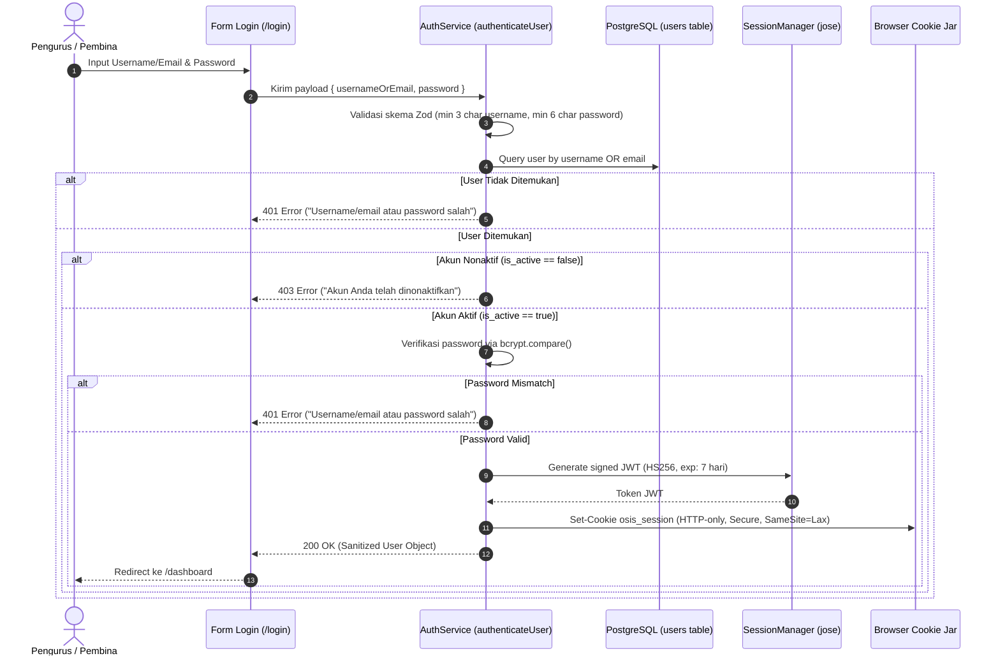
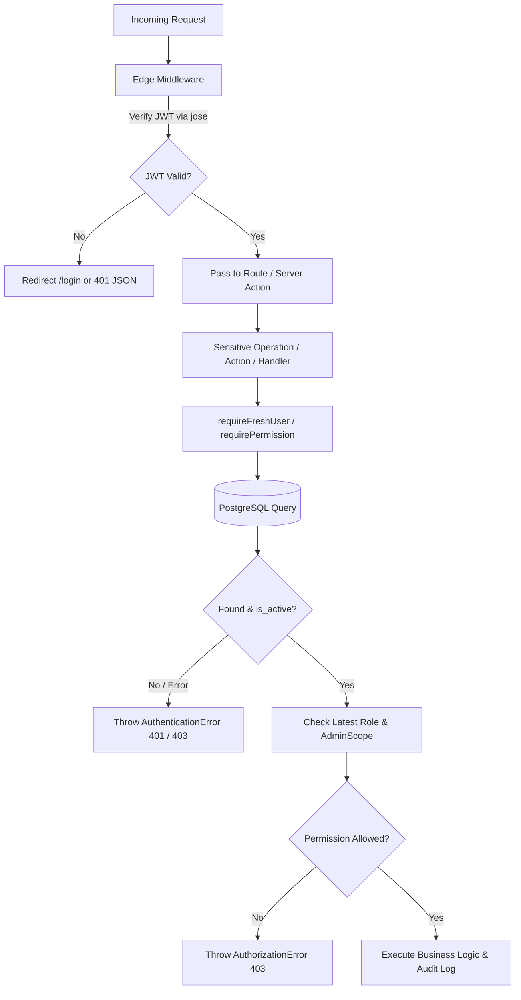

# Authentication & Authorization Architecture Specification
**OSIS MPK SMKN 11 BANDUNG — Attendance & Management System**
*Version: 1.1 (Task 04.1 Security Hardened)*

Dokumen ini merupakan panduan teknis resmi implementasi fondasi autentikasi dan otorisasi (*Authentication & Authorization Foundation*) pada OSIS MPK Attendance & Management System berbasis Next.js App Router (Next.js 16), Prisma 6, dan PostgreSQL. Dokumen ini telah diperbarui dengan hasil audit keamanan dan hardening pada Task 04.1.

---

## 1. Authentication Flow

Sistem mengadopsi alur autentikasi berbasis kredensial server-managed yang aman dengan proteksi username enumeration dan verifikasi status aktif pengguna:



### Karakteristik Kunci Alur Autentikasi:
1. **Single Entry Point Login:** Pengguna dapat masuk menggunakan `username` ATAU alamat `email`.
2. **Pencegahan Username Enumeration:** Pesan kesalahan seragam (`"Username/email atau password salah"`) baik saat identitas pengguna tidak ditemukan maupun saat password tidak cocok.
3. **Pemeriksaan Status Akun Aktif (`is_active`):** Akun yang dinonaktifkan (`is_active: false`) oleh Superadmin langsung diblokir sebelum verifikasi password diuji lebih lanjut.
4. **Tanpa Registrasi Publik:** Tidak disediakan endpoint atau antarmuka registrasi terbuka. Seluruh akun web dibuat dan dikelola secara privat oleh `SUPERADMIN`.
5. **Sanitasi Data Mutlak:** Field `password_hash` tidak pernah disertakan dalam return object atau dikirimkan ke client.

---

## 2. Session & Cryptographic Strategy

Sistem menggunakan strategi **Signed JWT dalam HTTP-only Cookie** menggunakan library standar industri `jose` dengan pemisahan modular antara penanganan kriptografi JWT (`lib/auth/session.ts`) dan manipulasi cookie Next.js (`lib/auth/cookies.ts`).

### 2.1. Spesifikasi Token JWT & Enforced Cryptography
- **Algoritma:** HMAC-SHA256 (`HS256`).
- **Algorithm Enforcement:** `jwtVerify()` secara eksplisit membatasi `algorithms: ['HS256']` untuk mencegah *algorithm-switching attack* (misalnya penyerang mencoba mengirim token `none` atau `RS256`).
- **Masa Berlaku:** 7 hari (`7 * 24 * 60 * 60` detik).
- **Validasi `AUTH_SECRET`:** Wajib didefinisikan dengan panjang minimal 32 karakter. Jika `AUTH_SECRET` kosong atau kurang dari 32 karakter, sistem melempar error server-side fatal secara eksplisit (`ConfigurationError`) dan menolak penerbitan/verifikasi token.
- **Payload Data Session Token:**
  ```json
  {
    "sub": "user-uuid-1234",
    "username": "ketua_osis",
    "email": "ketua@smkn11bdg.sch.id",
    "role": "ADMIN",
    "admin_scope": "GENERAL",
    "member_id": "member-uuid-5678",
    "iat": 1731000000,
    "exp": 1731604800
  }
  ```

### 2.2. Spesifikasi Cookie
- **Nama Cookie:** `osis_session`
- **`httpOnly: true`:** Mencegah pembacaan token melalui script client-side (XSS protection).
- **`secure: process.env.NODE_ENV === "production"`:** Transmisi token hanya melalui HTTPS pada lingkungan produksi.
- **`sameSite: "lax"`:** Melindungi dari serangan Cross-Site Request Forgery (CSRF).
- **`path: "/"`:** Berlaku di seluruh rute aplikasi.
- **`maxAge: 7 * 24 * 60 * 60`:** Sinkron dengan masa berlaku JWT (7 hari).
- **Logout Invalidation:** Logout membersihkan cookie dengan menyetel nilai kosong, `maxAge: 0`, dan `expires: new Date(0)`.

---

## 3. Fresh Authorization Architecture (Zero-Stale Policy)

Untuk mencegah eskalasi hak akses atau kebocoran otorisasi saat ada perubahan role, admin scope, atau penonaktifan akun (`is_active = false`), sistem memisahkan otentikasi sesi dan otorisasi aksi:



### 3.1. Dual Context Separation
1. **`getSessionUser()` (Edge & Presentation Layer):**
   - Membaca payload JWT dari cookie tanpa query database.
   - Digunakan oleh middleware untuk route gating dan oleh server components read-only non-sensitif untuk menampilkan identitas pengguna.
2. **`getFreshUser()` / `requireFreshUser()` (Data-Mutating & Sensitive Operations):**
   - Wajib dieksekusi sebelum melakukan aksi sensitif, mutasi data, pembuatan jadwal, koreksi absensi, dan konfigurasi.
   - Mengambil data terbaru dari tabel `users` di database berdasarkan `user_id` dari session.
   - **Zero Fallback Policy:** Jika pengguna dinonaktifkan (`is_active: false`), diubah perannya, atau jika query database gagal, sistem **TIDAK PERNAH** fallback ke klaim JWT lama. Permintaan langsung ditolak dengan `AuthenticationError`.
3. **`requirePermission(module, action)`:**
   - Menghubungkan pengambilan `freshUser` dengan evaluasi matriks RBAC terkini. Jika role atau scope pengguna telah diubah di DB oleh Superadmin beberapa detik sebelumnya, izin baru langsung berlaku seketika.

---

## 4. Web & API Security Hardening

### 4.1. CSRF Protection via Origin Validation
Fungsi `validateRequestOrigin(request)` diterapkan di `middleware.ts` untuk memeriksa setiap request dengan metode mutasi (`POST`, `PUT`, `PATCH`, `DELETE`):
- Memeriksa header `Origin` atau `Referer`.
- Membandingkan host asal request dengan header `Host` atau `x-forwarded-host`.
- Jika terjadi *mismatch* origin atau berasal dari domain eksternal tidak tepercaya, request langsung ditolak dengan HTTP `403 Forbidden` (`CSRF validation failed: Invalid request origin`).

### 4.2. Open Redirect Protection
Fungsi `sanitizeRedirectUrl(target, defaultPath = '/dashboard')` memvalidasi parameter `redirect` pada halaman login:
- Mencegah *protocol-relative URLs* (misal: `//attacker.com`).
- Mencegah *Windows backslash exploit* (misal: `/\attacker.com` atau `\/attacker.com`).
- Mencegah URI scheme injection (misal: `javascript:...`, `data:...`).
- Menolak redirect ke host/origin eksternal, hanya mengizinkan URL lokal internal (`path.startsWith('/') && !path.startsWith('//')`).

### 4.3. Password Hashing Strategy
- **Library:** `bcryptjs`
- **Cost Factor (Salt Rounds):** `12`
- **Fungsi:**
  - `hashPassword(password: string): Promise<string>`
  - `verifyPassword(password: string, hashedPassword: string): Promise<boolean>`
- **Prinsip Immutabilitas:** Password plaintext tidak pernah disimpan di database, variabel global, session token, atau log sistem.

---

## 5. Role & AdminScope Authorization Matrix

Sistem mengadopsi prinsip **Denial by Default** (akses ditolak jika tidak secara eksplisit diizinkan dalam aturan otorisasi).

### 5.1. Hirarki Role
1. **`SUPERADMIN`:**
   - Memiliki akses penuh tanpa batas ke seluruh modul, aksi CRUD, pengaturan sistem, dan registrasi perangkat scanner.
2. **`ADMIN`:**
   - Akses operasional dibatasi ketat berdasarkan **`admin_scope`**.
   - Dilarang mengakses modul `SYSTEM_SETTINGS`.
   - Dilarang melakukan aksi `DELETE` pada data master (Members, Executives, Divisions, Activities, dll).
3. **`VIEWER` (Pembina OSIS/MPK):**
   - Akses murni **READ-ONLY** pada modul monitoring dan **EXPORT** pada modul laporan.
   - Dilarang keras melakukan aksi `CREATE`, `UPDATE`, `DELETE`, `CORRECT`, atau `MANAGE_SESSION`.
   - Dilarang mengakses modul `SYSTEM_SETTINGS` dan `IOT_DEVICES`.

### 5.2. Matriks Otorisasi Scope ADMIN (Verified & Hardened)

| Modul | GENERAL (Ketum/Wakil) | SECRETARY (Sekretaris) | DISCIPLINE_4P (Komisi 4P) | TREASURER (Bendahara) |
| :--- | :---: | :---: | :---: | :---: |
| **DASHBOARD** | READ | READ | READ | READ |
| **MEMBERS** | C, R, U | R, U (Kontak/RFID) | R | R |
| **EXECUTIVES** | C, R, U | R | NO ACCESS | NO ACCESS |
| **DIVISIONS** | C, R, U | R | NO ACCESS | NO ACCESS |
| **ACTIVITIES** | C, R, U | R | NO ACCESS | NO ACCESS |
| **SCHEDULES** | C, R, U, Buka/Tutup | C, R, U, Buka/Tutup | R | C, R, U (Danusan only) |
| **ATTENDANCE** | R, Input Manual | R, Input Izin/Sakit | R (Live Monitor) | R (Live Danusan) |
| **HISTORY & CORRECTION**| R, Koreksi + Audit | R, Koreksi + Audit | R | R |
| **VIOLATIONS** | C, R, U | R | C, R, U, Tindak Lanjut | NO ACCESS |
| **REPORTS** | R, Export | R, Rekap ALPA, Export | R, Export (Disiplin) | R, Export (Danusan) |
| **SYSTEM_SETTINGS** | **NO ACCESS** | **NO ACCESS** | **NO ACCESS** | **NO ACCESS** |
| **IOT_DEVICES** | R (Status Monitor) | **NO ACCESS** | **NO ACCESS** | **NO ACCESS** |

*Keterangan:* `C` = Create, `R` = Read, `U` = Update. Action `DELETE` ditolak untuk semua ADMIN pada master data. Modul `SYSTEM_SETTINGS` eksklusif SUPERADMIN.

### 5.3. Implementasi Utility Otorisasi
- `canAccessModule(user, module, action): boolean`: Fungsi murni penentu izin.
- `assertAuthorized(user, module, action): void`: Melempar `AuthorizationError` jika pengguna tidak memiliki hak akses.
- `assertRole(user, allowedRoles): void`: Memastikan peran pengguna termasuk dalam daftar yang diizinkan.

---

## 6. Route & API Protection Strategy

### 6.1. Next.js 16 Proxy (`proxy.ts`)
1. **Rute Dashboard Terproteksi:**
   - Semua rute yang diawali dengan `/dashboard`, `/members`, `/executives`, `/divisions`, `/activities`, `/schedules`, `/attendance`, `/violations`, `/reports`, `/settings`, dan `/devices`.
   - Jika pengguna belum terotentikasi, proxy menghentikan request dan melakukan pengalihan (*redirect*) ke:
     `/login?redirect=[sanitized_encoded_current_path]`
2. **Rute Autentikasi (`/login`):**
   - Jika pengguna yang sudah login mencoba mengakses `/login`, proxy secara otomatis mengarahkannya ke `/dashboard`.
3. **Pengecekan Kriptografis Ringan:**
   - Proxy memverifikasi token cookie `osis_session` menggunakan Web Crypto API via `jose` tanpa query database.

### 6.2. Internal API Routes (`/api/*` selain IoT, Health, dan Setup):
- Diperiksa oleh proxy; jika token cookie tidak sah, mengembalikan respons JSON:
  ```json
  { "error": "Unauthorized: Otentikasi sesi dibutuhkan." }
  ```
  dengan HTTP Status `401 Unauthorized`.
- Setiap mutasi method (`POST`, `PUT`, `PATCH`, `DELETE`) divalidasi origin/referer untuk pencegahan CSRF.

### 6.3. Endpoint Publik & Khusus:
1. **Health Check Endpoint (`GET /api/health`):**
   - Endpoint pemantauan publik tanpa otentikasi sesi cookie.
   - Mengembalikan status aplikasi, status konektivitas basis data (`connected`/`disconnected`), latensi, dan timestamp server tanpa membocorkan kredensial.
2. **Initial SUPERADMIN Setup (`POST /api/auth/setup-superadmin`):**
   - Endpoint inisialisasi akun Superadmin pertama.
   - Wajib menyertakan `setupSecret` yang cocok dengan `INITIAL_SUPERADMIN_SECRET` di server.
   - Ditolak seketika jika akun Superadmin sudah pernah dibuat.
3. **IoT Device Endpoint (`/api/v1/iot/*`):**
   - Dikecualikan dari otentikasi cookie web.
   - Diproteksi menggunakan `Authorization: Bearer <DEVICE_API_KEY>` yang dicocokkan dengan `api_key_hash` pada tabel `devices`.

---

## 7. Environment Variables & Security Constraints

| Variabel | Tipe | Keterangan | Validasi / Constraint |
| :--- | :---: | :--- | :--- |
| `DATABASE_URL` | String | URL koneksi ke basis data PostgreSQL | Wajib berupa valid connection string PostgreSQL |
| `AUTH_SECRET` | String | Kunci rahasia penandatanganan JWT | **Wajib minimal 32 karakter** (ditegakkan via runtime assertion) |
| `INITIAL_SUPERADMIN_SECRET` | String | Kunci rahasia satu kali untuk setup Superadmin perdana | **Wajib minimal 16 karakter** (ditegakkan via Zod & service validation) |
| `NODE_ENV` | String | Lingkungan aplikasi (`development`, `production`, `test`) | Mengatur flag `secure` pada cookie sesi |

---

## 8. Initial SUPERADMIN Setup Procedure

Untuk menjaga keamanan, aplikasi tidak menyediakan registrasi publik dan tidak menggunakan kredensial default yang di-hardcode.

### Prosedur Setup Akun Pertama:
1. Pastikan variabel `INITIAL_SUPERADMIN_SECRET` telah dikonfigurasi di `.env` (minimal 16 karakter).
2. Jalankan perintah CLI:
   ```bash
   npm run setup:superadmin
   ```
   atau kirimkan request HTTP POST ke `/api/auth/setup-superadmin`:
   ```json
   {
     "username": "superadmin_osis",
     "email": "superadmin@smkn11bdg.sch.id",
     "password": "PasswordSangatKuat2026!",
     "setupSecret": "<NILAI_INITIAL_SUPERADMIN_SECRET>"
   }
   ```
3. Akun akan dibuat di dalam Prisma interactive transaction dengan role `SUPERADMIN`.
4. Percobaan inisialisasi ulang berikutnya akan langsung ditolak (`403 Forbidden`).

---

## 9. Verification & Testing Evidence

Keamanan arsitektur dan integrasi database diverifikasi melalui rangkaian 21 unit & integration test otomatis pada Node.js native test runner (`npm test`):
1. **JWT Verification:** Menerbitkan dan memvalidasi token JWT dengan klaim lengkap.
2. **Tampered Token:** Token yang diubah karakternya ditolak.
3. **Expired Token:** Token kedaluwarsa ditolak secara konsisten.
4. **Weak `AUTH_SECRET` Rejection:** Nilai secret kurang dari 32 karakter langsung melempar error konfigurasi server.
5. **SUPERADMIN Access:** Akses penuh ke seluruh modul termasuk `SYSTEM_SETTINGS` dan `DELETE`.
6. **VIEWER Read-Only:** VIEWER dapat membaca data dan export laporan, namun ditolak saat mencoba aksi `CREATE`, `UPDATE`, `DELETE`, `CORRECT`, atau modul terlarang.
7. **ADMIN Scope Isolation:** ADMIN hanya dapat mengakses modul yang diizinkan sesuai perannya.
8. **ADMIN Privilege Denial:** ADMIN ditolak dari modul `SYSTEM_SETTINGS` dan aksi `DELETE` master data.
9. **Authorization Assertions:** Fungsi `assertAuthorized` dan `assertRole` melempar `AuthorizationError` saat akses ilegal.
10. **Open Redirect Sanitization:** Menguji pencegahan redirect ke domain eksternal, URL berbasis scheme ganda, `//`, dan `/\`.
11. **CSRF Origin Validation:** Request mutasi dengan origin eksternal berhasil diblokir.
12. **Password Hashing (bcrypt):** Raw password tidak pernah disimpan, verifikasi valid vs invalid.
13. **Login Schema Validation:** Menolak username/password kosong atau terlalu pendek.
14. **Generic Auth Errors:** Pesan error seragam untuk user tidak ditemukan vs password salah (mencegah username enumeration).
15. **Inactive User Block:** Akun dengan `is_active: false` ditolak seketika.
16. **Stale JWT vs Fresh DB Role:** Klaim peran lawas pada JWT tidak dapat digunakan untuk mengeksekusi operasi jika hak akses di database telah dicabut.
17. **Fresh Active Check:** Akun yang dinonaktifkan di DB langsung kehilangan hak otorisasi meskipun memiliki JWT aktif.
18. **Superadmin Setup Schema:** Validasi format username, email, dan panjang minimal password (>=8 karakter).
19. **Setup Secret Enforcement:** Menolak setup jika secret tidak cocok atau belum diset di server.
20. **One-Time Superadmin Protection:** Menolak setup kedua jika Superadmin sudah ada dalam sistem.
21. **Database Singleton Health Check:** Memverifikasi ketersediaan koneksi basis data.

Semua 21 test case lolos 100% (*21 passed, 0 failed*).

